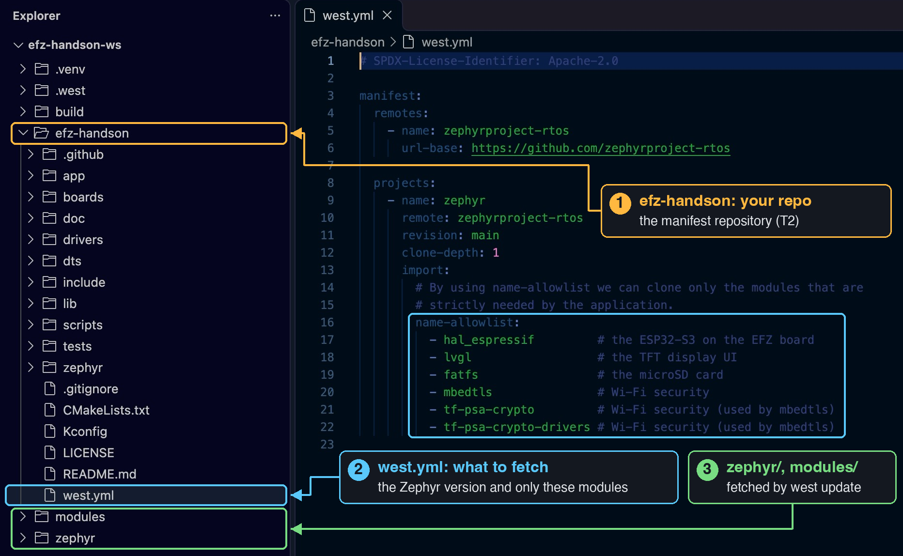

# Hands-on Workspace (T2)

From here on, the lessons use a new repository, [efz-handson](https://github.com/huunghiaspkt/efz-handson). It's set up the way most real products on Zephyr are. If it feels like a big step from the Basic lessons, that's fine. You'll see why it's worth it as you go.

<br/>

---

## T1 and T2: who owns the workspace



A west workspace always has one **manifest repository**: the one that holds `west.yml`, the list of every repository the workspace needs. Zephyr's documentation names the common layouts:

- **T1, Zephyr is the manifest.** That's the workspace from [How to Start](../how-to-start): you cloned Zephyr (our fork), and your apps live inside it. Great for learning.
- **T2, your application is the manifest.** Your own repository holds `west.yml`. It picks the Zephyr version and lists only the modules your board needs. Zephyr comes in as a dependency, next to your code.

When I build a real product on Zephyr, I use T2. My repository is in charge: a new person on the team clones one repository, runs `west init`, and gets exactly the same workspace as everyone else. That's why the Intermediate lessons use it too.

This is the whole `west.yml` of efz-handson:

```yaml title="efz-handson/west.yml"
manifest:
  remotes:
    - name: zephyrproject-rtos
      url-base: https://github.com/zephyrproject-rtos

  projects:
    - name: zephyr
      remote: zephyrproject-rtos
      revision: main
      clone-depth: 1
      import:
        name-allowlist:
          - hal_espressif         # the ESP32-S3 on the EFZ board
          - lvgl                  # the TFT display UI
          - fatfs                 # the microSD card
          - mbedtls               # Wi-Fi security
          - tf-psa-crypto         # Wi-Fi security (used by mbedtls)
          - tf-psa-crypto-drivers # Wi-Fi security (used by mbedtls)
```

It follows Zephyr `main`. A product would pin a release tag in `revision` instead.

<br/>

---

## Set it up

You need the tools from [How to Start](../how-to-start) (Python, the Zephyr SDK). Then, in the folder where you keep your projects:

```bash
# Python environment with west, inside the workspace folder
python3 -m venv efz-handson-ws/.venv
source efz-handson-ws/.venv/bin/activate
pip install west
# initialize efz-handson-ws for efz-handson (main branch)
west init -m https://github.com/huunghiaspkt/efz-handson --mr main efz-handson-ws
# update Zephyr and the modules (latest commit only, no git history)
cd efz-handson-ws
west update --narrow -o=--depth=1
source .venv/bin/activate
west packages pip --install
west blobs fetch hal_espressif
```

`--narrow -o=--depth=1` skips the git history of every repository: about 1.2 GB instead of 2.4 GB.

:::tip[Windows]
Activate the environment with `efz-handson-ws\.venv\Scripts\activate` (and `.venv\Scripts\activate` inside the workspace) instead of `source …/bin/activate`. The other commands are the same.
:::

You end up with:

```
efz-handson-ws/
├── .venv/          Python environment (west, esptool, …)
├── .west/          west's own settings
├── efz-handson/    the manifest repository: board, app, west.yml
├── zephyr/         upstream Zephyr
└── modules/        only the modules listed in west.yml
```

<br/>

---

## What's in efz-handson

Most of the tree follows Zephyr's own layout (it's the same as Zephyr's [example-application](https://github.com/zephyrproject-rtos/example-application)), so keep it as it is:

| Path | What it is |
|---|---|
| `boards/embeddedfun/efz_esp32s3/` | the EFZ-ESP32S3 board: Zephyr finds boards in `boards/<vendor>/<board>/` |
| `zephyr/module.yml` | makes the repository a Zephyr module, so Zephyr finds the board and `dts/` |
| `dts/bindings/` | devicetree bindings and the `embeddedfun` vendor prefix |
| `app/` | the application: `CMakeLists.txt`, `prj.conf`, `Kconfig` |
| `drivers/`, `lib/`, `tests/` | out-of-tree drivers, libraries and Twister tests |

The part you can change is `app/src/`. There I keep one folder per part of the board in `app/src/modules/` (env for the SHT30, io for the buttons and LEDs), and the LCD code in `app/src/lcd/`. If you prefer another layout inside `src`, go ahead, and update `app/CMakeLists.txt` and `app/Kconfig` to match.

<br/>

---

## Build, flash, monitor

From `efz-handson-ws`, with the environment active:

```bash
west build -b efz_esp32s3/esp32s3/procpu efz-handson/app
west flash
west espressif monitor
```

Each module has a switch in `app/prj.conf` (for example `# CONFIG_APP_MODULE_IO=n`). Set it to `n` and rebuild to leave that module out.

Next: [Sensors](./i2c-sensors) reads the SHT30 and shows it on the LCD.
