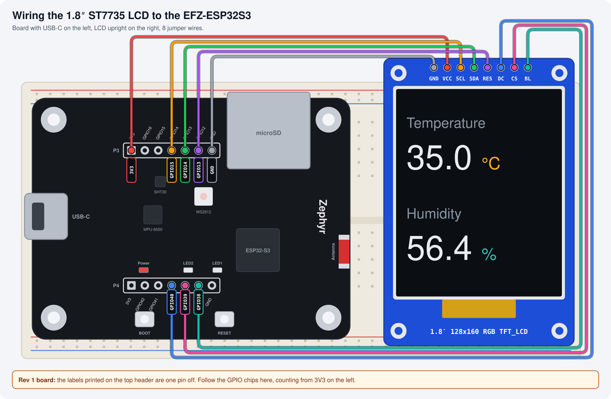

# Sensors

The previous four pages described, validated, and compiled the SHT30 driver into your firmware — through the [devicetree](./devicetree), the [binding](./binding-yaml), and [Kconfig](./kconfig). This page reads from it.

Zephyr's sensor API provides a uniform interface for every sensor, regardless of interface (I2C, SPI) or manufacturer. If a driver exists in the Zephyr tree, reading a sensor is always the same three steps:

1. Get the device
2. Call `sensor_sample_fetch()`
3. Call `sensor_channel_get()` for each measurement

<br/>

---

## Wire the LCD

This lesson runs in the [Hands-on Workspace (T2)](./hands-on-workspace): set it up first if you haven't. From this lesson on, the readings also show on a 1.8″ ST7735 LCD (128x160). Connect it to the board with eight jumper wires:



| LCD pin | Board header | GPIO | Job |
|---|---|---|---|
| GND | top (P3) | GND | Ground |
| VCC | top (P3) | 3V3 | 3.3 V supply |
| SCL | top (P3) | GPIO15 | SPI clock |
| SDA | top (P3) | GPIO14 | SPI data |
| RES | top (P3) | GPIO13 | Reset |
| DC | bottom (P4) | GPIO40 | Data or command |
| CS | bottom (P4) | GPIO39 | Chip select |
| BL | bottom (P4) | GPIO38 | Backlight, high = on |

:::warning[Rev 1 boards]
The labels printed next to the top header (P3) are one pin off. They read 3V3, 16, 15, 14, 13, 12, GND, but the real pins are 3V3, GPIO26, 16, 15, 14, 13, GND. Count the pins from 3V3 instead of trusting the printed numbers: SCL goes on the 4th pin (printed "14"), SDA on the 5th (printed "13"), RES on the 6th (printed "12"). The bottom header (P4) is labelled correctly.
:::

<br/>

---

## The sensor API — reading the SHT30

This is the course sample [`03_intermediate/i2c_sensor`](https://github.com/huunghiaspkt/zephyr/tree/main/samples/efz_samples/03_intermediate/i2c_sensor):

```c title="src/main.c"
#include <zephyr/drivers/sensor.h>
#include <zephyr/logging/log.h>

LOG_MODULE_REGISTER(sht30_demo, LOG_LEVEL_INF);

/* Step 1: get the device (resolved at compile time from DTS) */
static const struct device *sht30 = DEVICE_DT_GET(DT_NODELABEL(sht30));

int main(void)
{
    struct sensor_value temp, hum;

    if (!device_is_ready(sht30)) {
        LOG_ERR("SHT30 not ready");
        return -ENODEV;
    }

    while (1) {
        /* Step 2: trigger a measurement */
        sensor_sample_fetch(sht30);

        /* Step 3: read the measured values */
        sensor_channel_get(sht30, SENSOR_CHAN_AMBIENT_TEMP, &temp);
        sensor_channel_get(sht30, SENSOR_CHAN_HUMIDITY,     &hum);

        LOG_INF("T: %d.%06d C  RH: %d.%06d %%",
                temp.val1, temp.val2,
                hum.val1, hum.val2);

        k_sleep(K_SECONDS(10));
    }
}
```

```kconfig title="prj.conf"
CONFIG_I2C=y
CONFIG_SENSOR=y
CONFIG_SHT3XD=y
CONFIG_LOG=y
```

That's the whole app. The devicetree says "an SHT30 is on `i2c0` at `0x44`," Kconfig pulled in the driver, the binding validated the node — and now `sensor_sample_fetch` knows how to talk to it.

The code is identical on both boards because both devicetrees give the sensor the same node label, `sht30`. What differs is where that node comes from:

<BoardTabs>
<BoardTab value="esp32s3_devkitc">

The DevKitC has no sensor on board. Wire an SHT30 module to I2C0 — **SDA → GPIO1, SCL → GPIO2**, plus 3V3 and GND (leave ADDR low for address `0x44`) — and describe it in an overlay:

```dts title="boards/esp32s3_devkitc_procpu.overlay"
&i2c0 {
	status = "okay";
	clock-frequency = <I2C_BITRATE_STANDARD>;

	sht30: sht3xd@44 {
		compatible = "sensirion,sht3xd";
		reg = <0x44>;
	};
};
```

</BoardTab>
<BoardTab value="efz_esp32s3">

The SHT30 is soldered on the board (SDA GPIO17, SCL GPIO18) and already described in the board devicetree as `sht30` at `0x44`. **No overlay, no wiring** — build and flash.

</BoardTab>
</BoardTabs>

Real output on the EFZ-ESP32S3:

```
*** Booting Zephyr OS build 144e2f76c80f ***
[00:00:00.017,000] <inf> sht30_demo: T: 38.172732 C  RH: 51.496139 %
[00:00:10.017,000] <inf> sht30_demo: T: 38.060578 C  RH: 51.245895 %
```

:::tip[Reading warm?]
On the EFZ-ESP32S3 the SHT30 sits a few millimetres from the ESP32, so it picks up board heat and reads several degrees above room temperature. The sensor is fine — it's measuring the air it's actually in.
:::

<br/>

---

## `struct sensor_value` format

Sensor values use a fixed-point format to avoid floating point:

```c
struct sensor_value {
    int32_t val1;   /* Integer part */
    int32_t val2;   /* Fractional part (millionths) */
};
```

A reading of `24.319000 °C` is stored as `{.val1 = 24, .val2 = 319000}`.

To get a `double`:
```c
double temp_c = sensor_value_to_double(&temp);
```

:::info
`sensor_value_to_double()` is provided by Zephyr. Don't compute `val1 + val2 / 1e6` manually — the sign handling is subtle when values are negative.
:::

<br/>

---

## Supported sensor channels

The SHT30 fills in two channels — temperature and humidity. Other sensors fill in different channels from the same standard list:

| Channel constant | Meaning |
|---|---|
| `SENSOR_CHAN_AMBIENT_TEMP` | Temperature (°C) |
| `SENSOR_CHAN_HUMIDITY` | Relative humidity (%RH) |
| `SENSOR_CHAN_PRESS` | Atmospheric pressure (kPa) |
| `SENSOR_CHAN_ACCEL_XYZ` | 3-axis acceleration (m/s²) |
| `SENSOR_CHAN_GYRO_XYZ` | 3-axis angular velocity (rad/s) |
| `SENSOR_CHAN_LIGHT` | Ambient light (lux) |

Not every sensor supports every channel. If a channel isn't supported, `sensor_channel_get()` returns `-ENOTSUP` — ask the SHT30 for `SENSOR_CHAN_PRESS` and that's what you get.

The power of this design: the MPU-6500 on the EFZ-ESP32S3 sits on the same I2C bus and is read with exactly the same three calls — only the channel names change (`SENSOR_CHAN_ACCEL_XYZ`, `SENSOR_CHAN_GYRO_XYZ`). Swap one sensor for another in the devicetree, flip the driver's Kconfig symbol, and the application structure stays the same.

<br/>

---

## Next: write the driver yourself

Every step on this page ran through Zephyr's in-tree `sht3xd` driver. The next page, [Writing Drivers](./writing-drivers), has you build that driver yourself.
