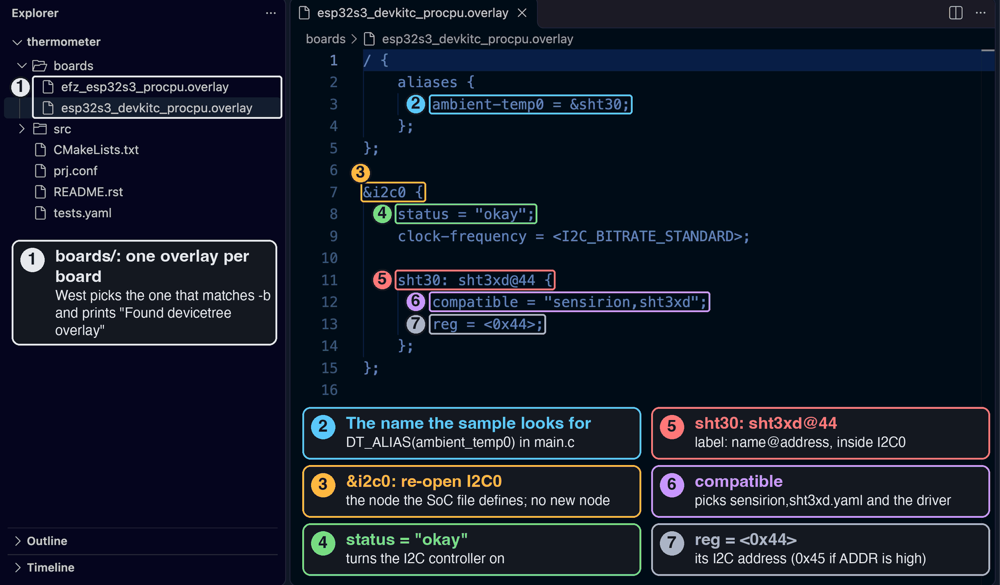

# Writing Overlays

When you flash Hello World, the board's hardware is already partially described — every board ships with a `.dts` file (upstream Zephyr for the ESP32-S3-DevKitC, the [EmbeddedFun fork](/docs/zephyr-training/how-to-start/environment) for the EFZ-ESP32S3). It defines the chip peripherals, the pins, the clocks.

But it does not know about **your application**. It does not know that you wired an SHT30 to I2C0 at address `0x44`, or that the sample you want to run looks for its sensor under a particular name. An overlay is your answer to that gap — a file where you describe exactly what your application needs on top of the board's base hardware.

**You write the overlay. Zephyr reads it at build time and wires everything up.**

<br/>

---

## Where does the overlay file live?

Your devicetree overlay lives in the application's `boards/` folder, named after your board. Our example on this page is Zephyr's own `samples/sensor/thermometer`, which prints the temperature of whatever sensor the devicetree points it at. You give it one overlay per board:

```
thermometer/
├── boards/
│   ├── efz_esp32s3_procpu.overlay
│   └── esp32s3_devkitc_procpu.overlay
├── CMakeLists.txt
├── prj.conf
└── src/
    └── main.c
```

The filename is the board name plus its qualifiers, with `/` replaced by `_`. Zephyr accepts two spellings for a board with a single SoC: the full one (`esp32s3_devkitc_esp32s3_procpu.overlay`) and a short one without the SoC part (`esp32s3_devkitc_procpu.overlay`). The course samples and Zephyr's own samples use the short one.

A project can hold overlays for several boards side by side — West only picks the one matching the `-b` you build for, and says so in the build output:

```
-- Found devicetree overlay: .../thermometer/boards/efz_esp32s3_procpu.overlay
```

:::tip
West finds the overlay automatically by matching the board name. You don't need to pass `-DDTC_OVERLAY_FILE=` unless you want a non-standard name.
:::

<br/>

---

## The SHT30 overlay

The thermometer sample gets its sensor with `DEVICE_DT_GET(DT_ALIAS(ambient_temp0))`. It doesn't care which chip that is; the overlay's job is to make `ambient-temp0` point at the SHT30.

<BoardTabs>
<BoardTab value="esp32s3_devkitc">

The DevKitC has no sensor on board. You wire an SHT30 module to I2C0 (SDA GPIO1, SCL GPIO2), so the overlay describes the sensor **and** names it:

```dts title="boards/esp32s3_devkitc_procpu.overlay"
/ {
    aliases {
        ambient-temp0 = &sht30;
    };
};

&i2c0 {
    status = "okay";
    clock-frequency = <I2C_BITRATE_STANDARD>;

    sht30: sht3xd@44 {
        compatible = "sensirion,sht3xd";
        reg = <0x44>;
    };
};
```

</BoardTab>
<BoardTab value="efz_esp32s3">

The SHT30 is soldered on the EFZ-ESP32S3, and its board DTS already describes it with the label `sht30`. The overlay only has to give the sample the name it looks for:

```dts title="boards/efz_esp32s3_procpu.overlay"
/ {
    aliases {
        ambient-temp0 = &sht30;
    };
};
```

That's the whole file. Most overlays on a board with a lot of hardware on it look like this: a few lines pointing at what's already there.

</BoardTab>
</BoardTabs>

To try it, copy the sample out of the Zephyr tree first, so your overlay doesn't end up inside Zephyr's own folder. From your workspace:

```bash
cp -r zephyr/samples/sensor/thermometer thermometer
```

Save the overlay for your board in `thermometer/boards/`, then build:

<BoardTabs>
<BoardTab value="esp32s3_devkitc">

```bash
west build -p -b esp32s3_devkitc/esp32s3/procpu thermometer
```

</BoardTab>
<BoardTab value="efz_esp32s3">

```bash
west build -p -b efz_esp32s3/esp32s3/procpu thermometer
```

</BoardTab>
</BoardTabs>

Here is the DevKitC overlay in VS Code, in the copied sample. Each number is one idea; the rest of this page takes them apart one by one:



<br/>

---

## Node references with `&`

The `&` syntax references a node defined elsewhere in the SoC or board DTS and lets you modify it. The DevKitC overlay opens I2C0, which the SoC file `esp32s3_common.dtsi` defines with the label `i2c0`:

```dts
&i2c0 {
    status = "okay";
    clock-frequency = <I2C_BITRATE_STANDARD>;
    ...
};
```

`&i2c0` does not create a new node — it opens the existing one for modification. Everything you write inside is added to it, and any property it already had with the same name is replaced.

`&sht30` in the alias works the same way: it refers to the node labelled `sht30`, wherever that node was written. On the DevKitC that's a few lines further down in your overlay; on the EFZ-ESP32S3 it's in the board DTS.

<br/>

---

## The `compatible` property

**This is the most important property. It is a string that binds a DTS node to a specific C driver:**

```dts
sht30: sht3xd@44 {
    compatible = "sensirion,sht3xd";
    ...
};
```

Zephyr looks up `dts/bindings/sensor/sensirion,sht3xd.yaml` to validate the node and generate the driver glue code. If no binding has that `compatible`, the node is never matched to a driver and the device never appears.

The format is always `"vendor,device"`. The vendor prefix follows the DTS bindings naming convention — `sensirion` is the manufacturer of the SHT3x family.

<br/>

---

## The `reg` property

`reg` identifies a device's position on its parent bus. For a child of an I2C controller, it is the device's 7-bit I2C address:

```dts
sht30: sht3xd@44 {
    compatible = "sensirion,sht3xd";
    reg = <0x44>;
};
```

The SHT30 answers on `0x44` when its ADDR pin is low and `0x45` when it's high. The `@44` in the node name is the unit address — it must always match `reg`. This is a DTS convention across all bus types.

:::note
The meaning of `reg` depends on the parent bus. On I2C it's the address; on SPI it's the chip-select index; for a memory-mapped peripheral it's `<base size>`. The `@address` convention is always the same.
:::

<br/>

---

## Status

Every peripheral node in the SoC DTS starts out `disabled`. Set `status = "okay"` to enable it. The DevKitC overlay enables I2C0:

```dts
&i2c0 {
    status = "okay";   /* without this the I2C controller never initializes */
    ...
};
```

On the EFZ-ESP32S3 the board DTS already does this, because the SHT30 is soldered on — that's why its overlay doesn't need the line.

If you leave the controller disabled, the build still succeeds, but the SHT30 under it never gets a working device: `device_is_ready()` returns false at runtime.

<br/>

---

## Pin routing with pinmux

For peripherals like I2C, UART and SPI, the physical pins are set in a pinmux group node that the board defines. The DevKitC's I2C0 pins come from its board files:

```dts title="boards/espressif/esp32s3_devkitc/esp32s3_devkitc-pinctrl.dtsi (excerpt)"
i2c0_default: i2c0_default {
    group1 {
        pinmux = <I2C0_SDA_GPIO1>,
                 <I2C0_SCL_GPIO2>;
        bias-pull-up;
        drive-open-drain;
        output-high;
    };
};
```

`I2C0_SDA_GPIO1` is a macro from the ESP32-S3 pinmux header that connects the I2C0 data signal to GPIO1. If you wire your SHT30 module to other pins, your overlay can re-open that group and change only the pins:

```dts
&i2c0_default {
    group1 {
        pinmux = <I2C0_SDA_GPIO8>,
                 <I2C0_SCL_GPIO9>;
    };
};
```

`bias-pull-up` and the other properties stay as the board set them; only `pinmux` changes. The ESP32-S3's GPIO matrix can route I2C0 to almost any pin, so the header has an `I2C0_SDA_GPIOn` / `I2C0_SCL_GPIOn` macro for each of them — porting to a new board is often just picking the right ones.

<br/>

---

## Aliases and labels

Aliases let application code find a device by a stable name regardless of where the node lives in the tree:

```dts
/ {
    aliases {
        ambient-temp0 = &sht30;   /* &sht30 is the node label on sht3xd@44 */
    };
};
```

This is the line from the thermometer sample's `src/main.c` that uses it:

```c
const struct device *const dev = DEVICE_DT_GET(DT_ALIAS(ambient_temp0));
```

Or, if you write your own app for this one board, by node label directly:

```c
const struct device *const dev = DEVICE_DT_GET(DT_NODELABEL(sht30));
```

The alias is what makes a sample portable: the same `main.c` runs on any board whose devicetree says which sensor `ambient-temp0` is.

:::note
DTS uses hyphens (`ambient-temp0`), C macros use underscores (`ambient_temp0`). Zephyr converts automatically.
:::

<br/>

---

## 😅 Don't panic — this is normal

If you look at the DevKitC overlay and think *"that's a lot of ceremony for one sensor"* — that reaction is completely expected.

```dts
&i2c0 {
    status = "okay";
    clock-frequency = <I2C_BITRATE_STANDARD>;

    sht30: sht3xd@44 {
        compatible = "sensirion,sht3xd";
        reg = <0x44>;
    };
};
```

Between the `&` references, the `status = "okay"` that seemingly does nothing visible, and the `compatible` string — Zephyr can feel like it demands a lot of configuration before you read a single temperature.

That is because it **is** doing a lot:

- 🔌 Describing the hardware that exists on the board
- 🎯 Selecting the exact driver that handles it
- 📡 Putting the sensor on the right bus, at the right address
- ⚡ Creating the device for your code — all at **compile time**, before a single line of your application runs

This is the design. It is also what makes Zephyr portable and production-grade.

:::tip[Stick with this series]
The **Intermediate** section walks through each of these layers — devicetree, Kconfig, driver bindings — one at a time, with the reasoning behind every decision. By the end, a configuration like this will read as naturally as a `for` loop. 💪
:::
