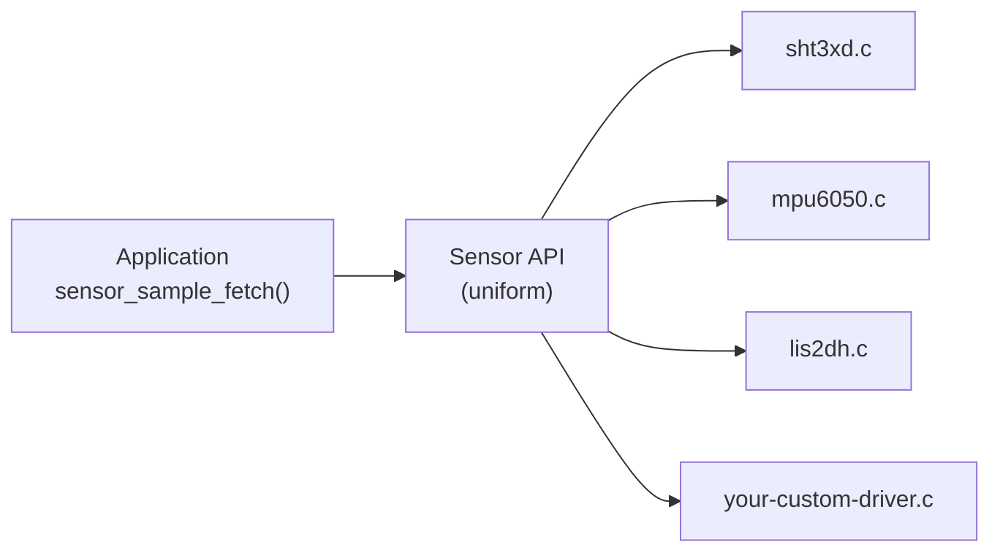

# Writing Drivers

You've spent four pages on the **consumer** side of the SHT30:

- The [devicetree](./devicetree) described it.
- The [binding YAML](./binding-yaml) validated it.
- The [Kconfig](./kconfig) compiled it in.
- The [sensor API](./i2c-sensors) read measurements from it.

Every step ran through the in-tree `sensirion,sht3xd` driver. This page flips the perspective — you build that driver yourself.

There are three reasons to reach for a custom driver, and the three exercises that follow map to each:

1. The hardware exists, but **Zephyr has no in-tree driver** for it.
2. The in-tree driver exists but **doesn't expose what you need** (raw register access, a vendor-specific mode, power management).
3. You're inventing a **new device class** that doesn't fit any existing Zephyr API.

<br/>

---

## The Zephyr driver model

Zephyr's driver model has one important property: **the API is decoupled from the implementation**. Your application calls `sensor_sample_fetch(dev)`; the kernel dispatches through a vtable to the right driver:



The contract is enforced by the **driver class API struct** — for sensors that's `struct sensor_driver_api`. Every sensor driver fills out this struct with its function pointers; `sensor_sample_fetch` is a thin wrapper that dereferences `dev->api->sample_fetch(dev, chan)`.

This is what makes the same `sensor_sample_fetch()` call work on hundreds of different sensors. Swap the driver, the application doesn't change.

<br/>

---

## Start from Zephyr's own driver

Before writing anything, look at how the SHT30 is read today. The board file gives the sensor a `compatible`:

```dts title="efz-handson/boards/embeddedfun/efz_esp32s3/efz_esp32s3_procpu.dts (excerpt)"
sht30: sht3xd@44 {
    compatible = "sensirion,sht3xd";
    reg = <0x44>;
};
```

That one string decides which driver runs the chip. It points at Zephyr's own driver, `zephyr/drivers/sensor/sensirion/sht3xd/sht3xd.c`, whose first line names the same compatible with underscores:

```c title="zephyr/drivers/sensor/sensirion/sht3xd/sht3xd.c"
#define DT_DRV_COMPAT sensirion_sht3xd
```

Scroll through it and you find the **three key parts every Zephyr driver has**:

1. **The API table**, `DEVICE_API(sensor, sht3xd_driver_api)`: the driver's functions (`sample_fetch`, `channel_get`, ...) under the names the sensor API expects. When the app calls `sensor_sample_fetch()`, the call lands here.
2. **A define macro**, `#define SHT3XD_DEFINE(inst)`: creates one device (its config, its data, its init) for one devicetree node.
3. **The for-each**, `DT_INST_FOREACH_STATUS_OKAY(SHT3XD_DEFINE)`: runs that macro once for every okay node with the driver's compatible.

Zephyr's driver also has a periodic mode, three repeatability levels and alert thresholds. Ours does one thing, a single measurement, so every line is easy to follow, and the steps are the same for a chip Zephyr doesn't support at all. The plan: write the driver in our own repository with our own compatible, then change that one string in the devicetree.

<br/>

---

## Exercise 1 — Your own SHT30 driver on the sensor API

**Goal:** a driver in the [EFZ hands-on workspace](./hands-on-workspace) that talks I2C to the SHT30 and exposes it through Zephyr's sensor API. The app from the [Sensors](./i2c-sensors) page keeps calling `sensor_sample_fetch()` / `sensor_channel_get()` exactly as before.

The code is in [efz-handson](https://github.com/huunghiaspkt/efz-handson) (`git pull` in `efz-handson-ws/efz-handson` if your workspace is older than this page):

```
efz-handson/
├── zephyr/module.yml                         # makes the repository a Zephyr module
├── dts/bindings/sensor/embeddedfun,sht30.yaml
├── drivers/
│   ├── Kconfig, CMakeLists.txt               # rsource / add_subdirectory down to sht30/
│   └── sensor/sht30/
│       ├── Kconfig
│       ├── CMakeLists.txt
│       └── sht30.c
└── app/boards/efz_esp32s3_procpu.overlay     # switches the board to our driver
```

The driver doesn't go inside Zephyr. `zephyr/module.yml` already tells Zephyr to read this repository's `Kconfig`, `CMakeLists.txt` and `dts/bindings/`, so the driver only needs those four new pieces: a binding, a Kconfig switch, a CMake file, and the C file.

The SHT30 is a friendly first driver: no calibration registers, no compensation formulas. You send a 16-bit command, wait, and read back six bytes:

| Byte | 0 | 1 | 2 | 3 | 4 | 5 |
|---|---|---|---|---|---|---|
| Content | T MSB | T LSB | T CRC | RH MSB | RH LSB | RH CRC |

### Step 1 — Binding

Give the driver its own `compatible`. `embeddedfun` is our vendor prefix, already listed in the repository's `dts/bindings/vendor-prefixes.txt`:

```yaml title="dts/bindings/sensor/embeddedfun,sht30.yaml"
# SPDX-License-Identifier: Apache-2.0

description: Sensirion SHT30 temperature and humidity sensor (efz-handson driver)

compatible: "embeddedfun,sht30"

include: [sensor-device.yaml, i2c-device.yaml]
```

`i2c-device.yaml` says the node sits on an I2C bus, so it needs a `reg` address, and the build checks for it. `sensor-device.yaml` marks it as a sensor.

### Step 2 — Kconfig and CMake

```kconfig title="drivers/sensor/sht30/Kconfig"
# SPDX-License-Identifier: Apache-2.0

config EFZ_SHT30
    bool "SHT30 driver (efz-handson)"
    default y
    depends on DT_HAS_EMBEDDEDFUN_SHT30_ENABLED
    select I2C
    select CRC
```

The switch turns itself on when the devicetree has an okay node with our compatible, and pulls in I2C and the CRC library. CMake only compiles the driver when the switch is on:

```cmake title="drivers/sensor/sht30/CMakeLists.txt"
# SPDX-License-Identifier: Apache-2.0

zephyr_library()
zephyr_library_sources(sht30.c)
```

`drivers/CMakeLists.txt` and `drivers/sensor/CMakeLists.txt` lead down to it with `add_subdirectory_ifdef()`, and the two Kconfig files with `rsource`. It's the same pattern Zephyr uses for its own drivers.

### Step 3 — The top of `sht30.c`

```c title="drivers/sensor/sht30/sht30.c"
#define DT_DRV_COMPAT embeddedfun_sht30

#include <zephyr/device.h>
#include <zephyr/drivers/i2c.h>
#include <zephyr/drivers/sensor.h>
#include <zephyr/kernel.h>
#include <zephyr/sys/byteorder.h>
#include <zephyr/sys/crc.h>
#include <zephyr/logging/log.h>

LOG_MODULE_REGISTER(efz_sht30, CONFIG_SENSOR_LOG_LEVEL);

#define SHT30_CMD_MEASURE_HIGH 0x2400    /* single shot, high repeatability */
#define SHT30_MEASURE_WAIT_MS  15

struct sht30_data {
    uint16_t t_raw;
    uint16_t rh_raw;
};

struct sht30_config {
    struct i2c_dt_spec i2c;
};
```

`DT_DRV_COMPAT` connects the C file to the binding: the same compatible, with the comma and the dash turned into underscores. Every `DT_INST_...` macro further down uses it to find the nodes that belong to this driver. `0x2400` asks for one measurement at high repeatability, which takes at most 15 ms (SHT3x datasheet).

Every Zephyr driver keeps two structs per device. `config` holds what the devicetree says (the I2C bus and address); it's constant, so it stays in flash. `data` holds what changes at run time (the last raw reading), so it lives in RAM.

### Step 4 — `sample_fetch` and `channel_get`

`sample_fetch` does the I2C work; `channel_get` only converts what's already stored:

```c
/* Each 16-bit word is followed by a CRC-8 (poly 0x31, init 0xFF). */
static bool sht30_crc_ok(const uint8_t *word)
{
    return crc8(word, 2, 0x31, 0xFF, false) == word[2];
}

static int sht30_sample_fetch(const struct device *dev, enum sensor_channel chan)
{
    const struct sht30_config *cfg = dev->config;
    struct sht30_data *data = dev->data;
    uint8_t cmd[2];
    uint8_t rx[6];
    int ret;

    if (chan != SENSOR_CHAN_ALL) {
        return -ENOTSUP;
    }

    sys_put_be16(SHT30_CMD_MEASURE_HIGH, cmd);
    ret = i2c_write_dt(&cfg->i2c, cmd, sizeof(cmd));
    if (ret < 0) {
        return ret;
    }

    k_msleep(SHT30_MEASURE_WAIT_MS);

    ret = i2c_read_dt(&cfg->i2c, rx, sizeof(rx));
    if (ret < 0) {
        return ret;
    }

    if (!sht30_crc_ok(&rx[0]) || !sht30_crc_ok(&rx[3])) {
        return -EIO;
    }

    data->t_raw = sys_get_be16(&rx[0]);
    data->rh_raw = sys_get_be16(&rx[3]);
    return 0;
}

static int sht30_channel_get(const struct device *dev, enum sensor_channel chan,
                 struct sensor_value *val)
{
    const struct sht30_data *data = dev->data;

    switch (chan) {
    case SENSOR_CHAN_AMBIENT_TEMP:
        /* T = -45 + 175 * raw / 65535, in micro-degrees */
        return sensor_value_from_micro(val,
            -45000000LL + (int64_t)data->t_raw * 175000000LL / 65535);
    case SENSOR_CHAN_HUMIDITY:
        /* RH = 100 * raw / 65535, in micro-percent */
        return sensor_value_from_micro(val,
            (int64_t)data->rh_raw * 100000000LL / 65535);
    default:
        return -ENOTSUP;
    }
}
```

- **Fetch:** the SHT30 measures temperature and humidity together, so only `SENSOR_CHAN_ALL` is accepted. The command goes out high byte first (`sys_put_be16`), `i2c_write_dt` takes the bus and address from the config, and the driver sleeps 15 ms while the chip measures (other threads keep running).
- **CRC:** each 16-bit word is followed by a CRC-8 (polynomial `0x31`, start `0xFF`, SHT3x datasheet). If either check fails, the bytes were damaged on the bus, and fetch returns `-EIO` instead of a wrong temperature.
- **Get:** a switch on the channel, never touching the bus, so the app can get as many channels as it wants after one fetch. The datasheet formulas run in millionths, so there's no float in the driver; the numbers are too big for 32 bits, hence `int64_t`. `sensor_value_from_micro()` fills the two whole numbers of a `struct sensor_value`.

### Step 5 — The API table and init

```c
static DEVICE_API(sensor, sht30_api) = {
    .sample_fetch = sht30_sample_fetch,
    .channel_get = sht30_channel_get,
};

static int sht30_init(const struct device *dev)
{
    const struct sht30_config *cfg = dev->config;

    if (!i2c_is_ready_dt(&cfg->i2c)) {
        LOG_ERR("I2C bus not ready");
        return -ENODEV;
    }
    return 0;
}
```

The API table is **key part 1**: it lists our two functions under the names the sensor API expects. `sensor_sample_fetch(dev)` looks in `dev`'s table and calls `sht30_sample_fetch()`. Init runs once at boot; if it returns an error, Zephyr marks the device not ready, and the app's `device_is_ready()` check is false.

### Step 6 — One device per devicetree node

So far nothing has created a device. These last lines do:

```c
#define SHT30_DEFINE(inst)                                                \
    static struct sht30_data sht30_data_##inst;                       \
    static const struct sht30_config sht30_config_##inst = {          \
        .i2c = I2C_DT_SPEC_INST_GET(inst),                        \
    };                                                                \
    SENSOR_DEVICE_DT_INST_DEFINE(inst, sht30_init, NULL,              \
                     &sht30_data_##inst, &sht30_config_##inst, \
                     POST_KERNEL, CONFIG_SENSOR_INIT_PRIORITY, \
                     &sht30_api);

DT_INST_FOREACH_STATUS_OKAY(SHT30_DEFINE)
```

Read them from the bottom up:

- **Key part 2, the for-each:** `DT_INST_FOREACH_STATUS_OKAY` finds every okay node with our compatible and calls `SHT30_DEFINE()` once for each, numbered from 0. The EFZ-ESP32S3 has one SHT30, so it runs once, as `SHT30_DEFINE(0)`.
- **Key part 3, the define macro:** `##inst` glues the number onto the names, giving `sht30_data_0` and `sht30_config_0`, one pair per sensor. `I2C_DT_SPEC_INST_GET()` reads the node's bus and its `reg` address (`0x44`), so the driver never hardcodes them.
- `SENSOR_DEVICE_DT_INST_DEFINE()` creates the device: which node, the init function, `NULL` for power management (this driver has none), the data, the config, when init runs, and the API table.
- **Boot order:** the ESP32 I2C driver also starts at `POST_KERNEL`, with priority 50 (`CONFIG_I2C_INIT_PRIORITY`); sensors start at 90 (`CONFIG_SENSOR_INIT_PRIORITY`). Lower starts first, so the bus is always ready before our init checks it.

Together: the for-each finds the node, the define macro makes the device, and the device points at our API table, so the app's `sensor_sample_fetch()` lands in `sht30_sample_fetch()`.

### Step 7 — Switch the board to your driver

<BoardTabs>
<BoardTab value="esp32s3_devkitc" unsupported="the EFZ hands-on workspace (app, LCD, board files) is built for the EFZ-ESP32S3. The course sample zephyr/samples/efz_samples/03_intermediate/custom_driver has the same driver for both boards." />
<BoardTab value="efz_esp32s3">

The SHT30 is already in the board file, so the overlay only replaces its `compatible`. Zephyr's `sht3xd` driver isn't built any more, and ours is:

```dts title="app/boards/efz_esp32s3_procpu.overlay"
/* Read the SHT30 with our own driver instead of Zephyr's sht3xd. */
&sht30 {
    compatible = "embeddedfun,sht30";
};
```

Zephyr picks this file up by itself (board overlay), next to the LCD overlay the app already loads.

</BoardTab>
</BoardTabs>

One line changed in the app. In episode 7 it asked for the first `sensirion,sht3xd` device; now it asks for the node labeled `sht30`, whatever its compatible is, so it works with either driver:

```c title="app/src/modules/env/env.c"
static const struct device *const sht30 = DEVICE_DT_GET(DT_NODELABEL(sht30));
```

(and `app/src/modules/env/Kconfig` depends on `$(dt_nodelabel_enabled,sht30)` instead of `DT_HAS_SENSIRION_SHT3XD_ENABLED`).

### Step 8 — Build, check, run

From `efz-handson-ws`:

```bash
west build -p -b efz_esp32s3/esp32s3/procpu efz-handson/app
west flash
```

The build says `Found devicetree overlay: .../app/boards/efz_esp32s3_procpu.overlay` and compiles `drivers/sensor/sht30/sht30.c`. To see what the macro made, look at the build's own files:

- `build/zephyr/zephyr.dts`: the `sht30: sht3xd@44` node now has `compatible = "embeddedfun,sht30"`, with a comment saying it came from your overlay.
- `build/zephyr/include/generated/zephyr/devicetree_generated.h`: `#define DT_FOREACH_OKAY_INST_embeddedfun_sht30(fn) fn(0)`, the for-each expanded to exactly one call.
- The firmware itself:

  ```bash
  grep -E "sht30_(data|config)_0|__device_dts_ord_107$" build/zephyr/zephyr.map
  ```

  shows `.bss.sht30_data_0` (RAM), `.rodata.sht30_config_0` (flash) and the device `__device_dts_ord_107`, named after the node's number in the devicetree. `DEVICE_DT_GET()` in the app is a pointer to that object, fixed at compile time.

Then open the monitor:

```bash
west espressif monitor
```

```
<inf> env: SHT30 ready
<inf> env: 35.7 C, 54.3 %
<inf> env: 35.6 C, 54.3 %
```

One reading a second, as before. Flashed one after the other on the same board, Zephyr's driver and ours read within a few tenths of a degree.

:::tip[Your turn]
Rename `app/boards/efz_esp32s3_procpu.overlay` (for example to `.off`) and build again with `-p`. `build/zephyr/.config` now has `CONFIG_SHT3XD=y` and no `CONFIG_EFZ_SHT30`, and the monitor still prints readings: Zephyr's driver is back, and `env.c` didn't change.
:::

<br/>

---

## Exercise 2 — Add power management

:::info
Exercises 2 and 3 use the course sample [`custom_driver`](https://github.com/huunghiaspkt/zephyr/tree/main/samples/efz_samples/03_intermediate/custom_driver) in the Zephyr fork. Its driver is Exercise 1's under other names: `custom_sht30_*` and the compatible `zephyr,custom-sht30`.
:::

The in-tree `sht3xd` driver has **no PM support**: call `pm_device_action_run()` on it and you get `-ENOSYS`. Your driver can fill that gap.

What should "suspend" mean for an SHT30? In single-shot mode the chip already drops to idle after every measurement. But if anything left it in **periodic** mode (measuring on its own, several times a second), it keeps drawing current until it receives the *Break* command, `0x3093`. So our suspend sends Break — the sensor is guaranteed idle, whatever state it was in. On a board where the sensor's supply goes through a load switch, this callback is also where you'd switch the power off.

### Step 1 — PM action callback

```c
#include <zephyr/pm/device.h>
#include <zephyr/pm/device_runtime.h>

#define SHT30_CMD_BREAK  0x3093  /* stop periodic mode -> idle */

#ifdef CONFIG_PM_DEVICE
static int custom_sht30_pm_action(const struct device *dev,
                                  enum pm_device_action action)
{
    switch (action) {
    case PM_DEVICE_ACTION_SUSPEND:
        /* Make sure the chip is idle, not measuring periodically */
        return sht30_write_cmd(dev, SHT30_CMD_BREAK);
    case PM_DEVICE_ACTION_RESUME:
        /* Nothing to do: the next single-shot command wakes it */
        return 0;
    default:
        return -ENOTSUP;
    }
}
#endif
```

### Step 2 — Wrap fetch with runtime PM

In `sample_fetch`, request the device before talking to it and release after. The I2C transaction from Exercise 1 moves into a helper, `sht30_read_measurement()`:

```c
static int custom_sht30_sample_fetch(const struct device *dev,
                                     enum sensor_channel chan)
{
    int ret;

    if (chan != SENSOR_CHAN_ALL) {
        return -ENOTSUP;
    }

    ret = pm_device_runtime_get(dev);     /* resume if suspended */
    if (ret < 0) {
        return ret;
    }

    ret = sht30_read_measurement(dev);    /* command, wait, read, CRC */

    (void)pm_device_runtime_put(dev);     /* suspend when last user is done */
    return ret;
}
```

Zephyr ref-counts the requests. If three different threads call `sample_fetch` simultaneously, the chip wakes once and sleeps once. With `CONFIG_PM_DEVICE_RUNTIME` off, both calls compile to stubs that return 0 — the same driver works either way.

Runtime PM is off per device until someone turns it on. Do it at the end of `init`:

```c
static int custom_sht30_init(const struct device *dev)
{
    /* … bus-ready check as before … */
    return pm_device_runtime_enable(dev);
}
```

(Alternatively, add `zephyr,pm-device-runtime-auto;` to the devicetree node and Zephyr enables it for you.)

### Step 3 — Hook PM into the device macro

```c
#define CUSTOM_SHT30_DEFINE(inst)                                        \
    /* … data and config structs as before … */                          \
    PM_DEVICE_DT_INST_DEFINE(inst, custom_sht30_pm_action);              \
    SENSOR_DEVICE_DT_INST_DEFINE(inst,                                   \
        custom_sht30_init,                                               \
        PM_DEVICE_DT_INST_GET(inst),    /* <- PM handle */               \
        &custom_sht30_data_##inst,                                       \
        &custom_sht30_config_##inst,                                     \
        POST_KERNEL, CONFIG_SENSOR_INIT_PRIORITY,                        \
        &custom_sht30_api);

DT_INST_FOREACH_STATUS_OKAY(CUSTOM_SHT30_DEFINE)
```

<br/>

And in `prj.conf`:

```kconfig
CONFIG_PM_DEVICE=y
CONFIG_PM_DEVICE_RUNTIME=y
```

That's all the application needs. The driver handles the rest — and now `pm_device_action_run(sht30, PM_DEVICE_ACTION_SUSPEND)` returns `0` instead of `-ENOSYS`.

<br/>

---

## Exercise 3 — Create a custom driver API

The sensor API works because temperature and humidity are concepts every sensor shares. When your device doesn't fit an existing class — say, a "blinking LED" with a configurable period — you create a new API.

Here we'll build a **`blink` driver class**: one operation, `set_period_ms()`, that any blink-capable device must implement. One concrete implementation (`blink-gpio-led`) drives the LED via GPIO; another could drive it via PWM.

### Step 1 — Binding for the concrete device

```yaml title="dts/bindings/blink-gpio-leds.yaml"
description: GPIO-controlled blinking LED.

compatible: "blink-gpio-led"

include: base.yaml

properties:
  led-gpios:
    type: phandle-array
    required: true
  blink-period-ms:
    type: int
```

### Step 2 — Public API header

The header defines:
- The **`blink_driver_api` struct** — the vtable each driver fills out
- A **public function** (`blink_set_period_ms`) that calls through the vtable
- A **userspace syscall wrapper** so user-mode apps can call it safely

```c title="include/blink.h"
#include <zephyr/device.h>
#include <zephyr/toolchain.h>

__subsystem struct blink_driver_api {
    int (*set_period_ms)(const struct device *dev, unsigned int period_ms);
};

__syscall int blink_set_period_ms(const struct device *dev,
                                  unsigned int period_ms);

static inline int z_impl_blink_set_period_ms(const struct device *dev,
                                             unsigned int period_ms)
{
    __ASSERT_NO_MSG(DEVICE_API_IS(blink, dev));
    return DEVICE_API_GET(blink, dev)->set_period_ms(dev, period_ms);
}

static inline int blink_off(const struct device *dev)
{
    return blink_set_period_ms(dev, 0);
}

#include <zephyr/syscalls/blink.h>     /* auto-generated by the build */
```

`__subsystem` and `__syscall` are Zephyr macros that hook into the build system to generate the userspace shim. The `z_impl_` prefix is the convention for the kernel-mode implementation; userspace's `blink_set_period_ms` is generated from `__syscall` and routes through to it.

### Step 3 — Driver implementation against the new API

```c title="drivers/blink/gpio_led.c"
#define DT_DRV_COMPAT blink_gpio_led

#include <zephyr/drivers/gpio.h>
#include <blink.h>

struct blink_gpio_led_data {
    struct k_work_delayable blink_work;
    unsigned int period_ms;
};

struct blink_gpio_led_config {
    struct gpio_dt_spec led;
};

static int blink_gpio_led_set_period_ms(const struct device *dev,
                                        unsigned int period_ms)
{
    struct blink_gpio_led_data *data = dev->data;
    /* … reschedule the toggle work … */
    return 0;
}

static const struct blink_driver_api blink_gpio_led_api = {
    .set_period_ms = blink_gpio_led_set_period_ms,
};

static int blink_gpio_led_init(const struct device *dev);

#define BLINK_GPIO_LED_DEFINE(inst)                                         \
    static struct blink_gpio_led_data data##inst;                           \
    static const struct blink_gpio_led_config config##inst = {              \
        .led = GPIO_DT_SPEC_INST_GET(inst, led_gpios),                      \
    };                                                                      \
    DEVICE_DT_INST_DEFINE(inst, blink_gpio_led_init, NULL,                  \
        &data##inst, &config##inst,                                         \
        POST_KERNEL, CONFIG_BLINK_INIT_PRIORITY,                            \
        &blink_gpio_led_api);

DT_INST_FOREACH_STATUS_OKAY(BLINK_GPIO_LED_DEFINE)
```

Same pattern as Exercise 1 — but the API struct is **`blink_driver_api`** (defined by you), not `sensor_driver_api` (defined by Zephyr).

### From the application

```c
#include <blink.h>

const struct device *led = DEVICE_DT_GET_ANY(blink_gpio_led);
blink_set_period_ms(led, 500);   /* blink every 500 ms */
k_sleep(K_SECONDS(5));
blink_off(led);                  /* stop */
```

The application doesn't know whether `led` is GPIO-backed or PWM-backed. That's the whole point of the API class.

<br/>

---

## Summary — when to use which exercise

| Situation | Pattern |
|---|---|
| Hardware exists, Zephyr doesn't ship a driver for *your* variant | Exercise 1 — implement the standard API (sensor, led, display, …) |
| The driver works but can't be suspended (like the in-tree `sht3xd`) | Exercise 2 — add `PM_DEVICE_DT_INST_DEFINE` + a `pm_action` callback |
| No existing Zephyr API fits the device's behavior | Exercise 3 — define a new driver class header and one or more implementations |

:::info
Reference: [Zephyr Device Drivers guide](https://docs.zephyrproject.org/latest/kernel/drivers/index.html).

The three exercises on this page (custom sensor driver, adding PM, custom blink driver class) are adapted from the [Nordic Developer Academy nRF Connect SDK Intermediate — Lesson 7](https://academy.nordicsemi.com/courses/nrf-connect-sdk-intermediate/lessons/lesson-7-device-driver-dev/), reworked here around the SHT30 on the EFZ board. The Academy's reference source lives at [`NordicDeveloperAcademy/ncs-inter/l7`](https://github.com/NordicDeveloperAcademy/ncs-inter/tree/main/l7).
:::
